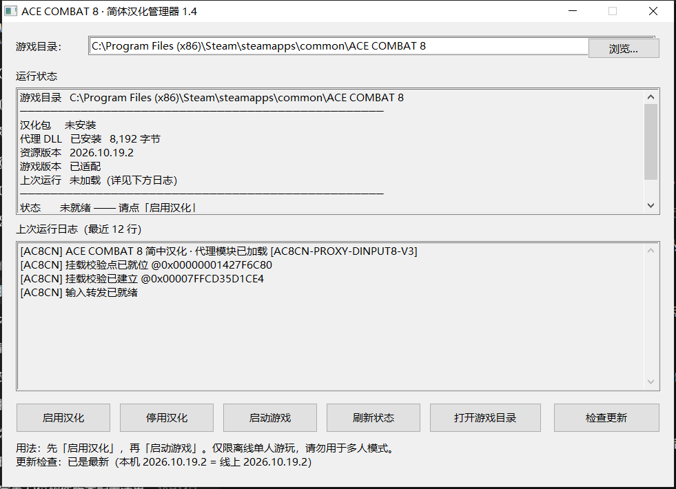

<p align="center">
  <br>
  <b>给《皇牌空战 8》装上完整简中文本的一键工具 —— 单文件、免管理员、随时还原</b><br>
  <a href="https://github.com/Carpenter-MK1/AC8_Better_CN_Localization/releases/latest"></a>
  <a href="https://github.com/Carpenter-MK1/AC8_Better_CN_Localization/releases"></a>
  
  
</p>

> ⚠️ **只用于离线单人游玩。** 启用汉化后**不要进多人模式** —— 反作弊可能判定为异常并**封号**。
> 想打多人请先点【停用汉化】。
>
> 本工具为非官方作品，**需要正版游戏**才能使用，不包含任何游戏本体资源。

[这是什么](#这是什么) • [快速开始](#快速开始) • [功能](#功能) • [常见问题](#常见问题) • [进阶](#进阶) • [更新日志](CHANGELOG.md)

---

## 这是什么

《皇牌空战 8》官方简体中文缺失的部分，由本工具补上：**4.6 万余条**界面文本、字幕、无线电通话、
机体图鉴与涂装说明。游戏原文件一个字节都不改，汉化以独立补丁包的形式挂在官方资源之后加载。

同类工具通常在替换文件时留下不可逆的痕迹。本工具的做法不一样：

- **只写两个文件**：`pakchunk0-Windows_998_P.pak`（译文）和 `dinput8.dll`（让未签名补丁包能被加载）
- **随时一键还原**：点【停用汉化】即删除上述两个文件，游戏立刻回到原版
- **改动前自动备份**：被覆盖的旧文件进 `_backup\`，出问题可以手动还原

## 快速开始

1. 到 [最新版本](https://github.com/Carpenter-MK1/AC8_Better_CN_Localization/releases/latest) 下载
   `AC8_CN_Manager_<版本>.zip`（约 590 KB）
2. 解压到任意位置 —— **不需要管理员权限**，也不要放进游戏目录
3. 双击 `AC8汉化管理器.exe`
4. 确认「游戏目录」指向正确位置（不对就点【浏览…】选）
5. 点【**启用汉化**】→ 点【**启动游戏**】

首次点【启用汉化】会弹出一份使用须知（免责声明 + 多人模式警告），需要停留 3 秒才能确认。
这份须知**每次安装都会出现** —— 发布包里不保存"已阅读"状态。

## 它做什么，不做什么

| 会做 | 不会做 |
|---|---|
| 只写入上面那两个**定名文件** | 不修改、不删除任何官方文件 |
| 停用时把这两个文件删掉 | 不碰存档、配置、输入设备设置 |
| 覆盖前把旧文件备份到 `_backup\` | 不联网上传任何数据 |
| 通过 Steam 启动游戏 | 不在游戏之外留驻任何进程 |

管理器只会读写 `Game\Content\Paks\` 与 `Game\Binaries\Win64\` 下的这两个文件名，
不会扫描、移动或删除其它文件。

## 功能

- **一键启用 / 停用** —— 装入或移除汉化文件，旧文件自动备份
- **状态自检** —— 汉化包是否就位（含构建时间）、代理 DLL 是否安装、游戏版本是否适配、
  上次启动有没有成功加载
- **启动游戏** —— 走 Steam 启动，不用在 Steam 里改启动参数
- **检查更新** —— 一键把译文包与代理 DLL 更新到最新版；下载后校验文件大小与 sha256，
  全部通过才替换，中途失败不动现有文件。启动时也会自动查一次（只有发现新版才提示）
- **命令行接口** —— `status` / `enable` / `disable` / `launch` / `check` / `update`，
  可以写进脚本

界面上的「汉化包 构建于 …」取自译文包自身的文件时间戳，反映的是**实际装着的那一版**，不是管理器版本。

## 常见问题

**启用了，但游戏里还是英文？**
按顺序查三件事：① 管理器状态是否显示「已启用 ＋ 就绪」；② `Game\Content\Paks\` 里是否存在
`pakchunk0-Windows_998_P.pak`；③ 启用前游戏是否已经开着 —— **必须先完全退出游戏**，再启用，再启动。

**为什么有的地方还是英文？**
HUD 上的目标标识（`GUN`、`MISSILE`、`FLARE` 等）是**离线渲染的位图字体**，不是文本，
替换译文无法覆盖。这部分与官方英文版一致，属于设计如此。

**游戏更新后失效了？**
游戏可执行文件一换，代理 DLL 用于识别的指纹就对不上了，它会主动放弃挂钩，状态显示
「游戏版本 **未适配**」—— 这是保护机制，不是故障。等对应版本的更新即可。

**杀毒软件报警怎么办？**
`dinput8.dll` 的作用是在游戏启动最早期挂钩资源加载，行为特征与注入类程序相同，被误报很正常。
本 DLL 全部源码在 [`src/proxy/`](src/proxy/)，只依赖 `kernel32`，不含任何第三方二进制。
确认后加入白名单即可，不必关闭杀毒软件。

**怎么彻底删干净？**
点【停用汉化】，然后删除管理器所在文件夹（`_backup\` 里是备份，可一并删）。
游戏目录里不会留下任何东西。

**能和其他 mod 共存吗？**
代理 DLL 的放行规则是**按包名通配**（`pakchunk0-Windows_<任意>_P.pak`），不是写死某一个名字，
所以使用其它编号的补丁包理论上可以共存 —— 但**与其它 mod 实际同时挂载的情况未做完整验证**。
如果对方 mod 也叫 `dinput8.dll`，两者只能留一个。

**进多人会不会封号？**
有风险，具体阈值未知。**别试。** 打多人前停用汉化。

<details>
<summary>国内下载不下来？</summary>

GitHub 在国内经常连不上。下面是实测可用的转发源，用法是在原地址前加前缀：

| 源 | 说明 |
|---|---|
| `https://ghfast.top/` + 原地址 | 可代下 Release 附件 |
| `https://cdn.jsdelivr.net/gh/Carpenter-MK1/AC8_Better_CN_Localization@main/` + 仓库内路径 | 只服务仓库文件，**不含 Release 附件** |

只更新汉化内容（不必重下整个 zip），可以直接取 `dist/` 下的文件：

- 译文包 `dist/pakchunk0-Windows_998_P.pak`
- 代理 DLL `dist/dinput8.dll`
- 更新清单 `dist/version.json`

下载后放进管理器的 `payload\` 目录（**文件名保持不变**），再点【启用汉化】。

> 这些都是第三方转发服务，可用性与安全性不由本项目保证。有条件时请直连 GitHub。

</details>

## 进阶

### 命令行

```
AC8汉化管理器.exe            图形界面
AC8汉化管理器.exe status     打印状态（就绪时退出码 0）
AC8汉化管理器.exe enable     启用汉化
AC8汉化管理器.exe disable    停用汉化
AC8汉化管理器.exe launch     启动游戏
AC8汉化管理器.exe check      只检查更新（0 = 已最新，3 = 有新版）
AC8汉化管理器.exe update     检查并下载更新
```

### 从源码构建

需要 [MinGW-w64 GCC](https://www.mingw-w64.org/)（含 `windres`）与 [zig](https://ziglang.org/)：

```bash
cd src/proxy && sh build.sh     # 先编代理 DLL
cd ../gui    && sh build.sh     # 再编管理器，产物在 AC8汉化管理器_发布版\
```

`src/proxy/selftest.py` 会从 `ac8proxy.c` 里抽出真实的包名匹配函数，生成 C 测试程序跑 15 个用例，
验证「自己的包被放行、官方容器不被误伤」。

### 工作原理

游戏会校验每个资源容器的数字签名，未签名的 `.pak` 直接被拒绝加载 —— 这是普通 mod 包放不进去的原因。
本工具用一个名为 `dinput8.dll` 的代理库，在游戏进程最早期挂钩容器构造函数，只对**补丁包**跳过签名校验，
官方容器完全不走这条路。

细节（挂钩位置、包名规则、更新清单格式）见 [docs/工作原理.md](docs/工作原理.md)。

## 已知限制

- **游戏更新后需要等待适配**：可执行文件指纹变化会让代理 DLL 主动停用。
- **HUD 位图文字不覆盖**：见上方常见问题。
- **只能与不同名的 `dinput8.dll` 共存**：同名会互相覆盖。
- **仅支持 Windows 10 / 11**。
- 汉化只覆盖**简体中文语言槽**的文本，不改变游戏的任何其它行为。

## 免责声明

- 本工具**非官方**，与游戏开发商、发行商没有任何关系。
- **需要正版游戏。** 本仓库与发布包不含任何游戏本体资源。
- **只用于离线单人游玩。** 启用汉化后进入多人模式可能被反作弊系统判定为异常并**封禁账号**。
- 使用本工具的一切后果由**使用者自行承担**；作者不对账号封禁、存档损坏、设备故障等任何损失负责。
- 强烈建议使用前**备份存档**。

## 许可

MIT，见 [LICENSE](LICENSE)。译文内容由本项目的译者贡献，欢迎提交修正。
